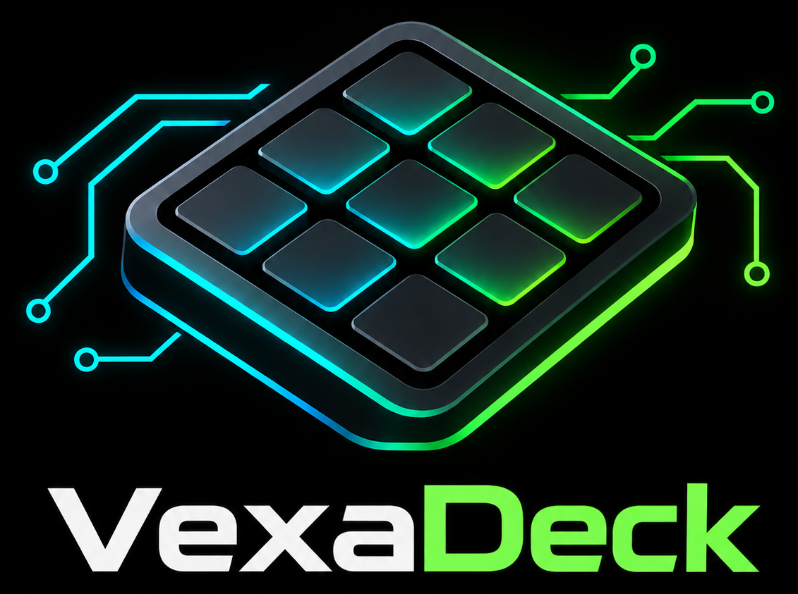

# VexaDeck 🎛️



Local LAN macro deck and hardware telemetry monitor for Windows. Turn any phone or tablet into your personal stream deck with zero cloud dependencies and absolute privacy.

## ✨ Key Features

- **100% Local & Private**: No accounts, no cloud servers, no telemetry, and no tracking. All traffic stays strictly within your local Wi-Fi LAN.
- **Secure LAN Connection (HTTPS/WSS)**: Self-contained local Certificate Authority (CA) generating dynamic SAN certificates for your local IPs. One-time QR code pairing.
- **Touch Mobile PWA**: Modern responsive interface built with React, Vite, and Tailwind CSS. Features haptic feedback (`navigator.vibrate`), reactive touch light glow, and a pure-black OLED mode.
- **Profile Auto-Switching**: Passive real-time foreground window detection (`SetWinEventHook`) matching active applications (VS Code, Spotify, games, terminal) with animated zoom transitions and per-profile accent colors.
- **Live Hardware Telemetry (4 slots)**: Continuous hardware metrics via LibreHardwareMonitor (CPU/GPU load & temp, RAM usage, and network traffic). Temperature alerts (>85°C) with pulsing borders and distinct vibration patterns.
- **Actions & Media Controls**: Keystroke macros (`hotkey`), master and per-app audio controls (WASAPI), audio output device switcher, synchronized toggles, and *Now Playing* media widget (GSMTC).
- **Bidirectional Clipboard**: Instant text sharing between mobile and PC with an in-memory history of the last 10 entries.
- **Secure Script Execution**: Whitelisted `.vbs` scripts running in an isolated directory with path-traversal prevention.
- **Integrated Admin Configuration**: Visual grid editor, profile manager, process matcher, and config import/export hosted inside a native WebView2 desktop window.

---

## 🚀 Installation & Usage

### What's new in 1.0.0
- **New name, same deck**: NexoDeck is now VexaDeck, with a new logo, installer and artifact names.
- **Stable Android connection**: the app signs each message with the correct direction and avoids duplicate connections, so it no longer gets stuck in a connect/disconnect loop.
- **Clean install**: VexaDeck uses a new Android `applicationId` and Windows AppId. The previous Android app is not updated in place: install VexaDeck and pair again.
- **Data preserved**: the server migrates the configuration from `%APPDATA%\NexoDeck` automatically, and the PWA keeps host, token and settings.

The full version history is in [`CHANGELOG.md`](CHANGELOG.md).

### Option 1: Official Installer (Recommended)
Download `VexaDeck-Setup-1.0.0.exe` from the Releases section or build it using the package script.
- Sets up an elevated scheduled task to run on Windows startup without UAC prompts.
- Configures Windows Firewall rules for private networks automatically.
- Allows choosing your custom data directory.

### Option 2: Portable Version
Download and extract `VexaDeck-1.0.0-portable.zip` anywhere. Configuration and runtime data are stored locally in the `data/` subfolder.

### Option 3: Android App
Download `VexaDeck-Android.apk` from the release, allow installing from unknown sources and scan the QR in **Panel → Pair → Android (app)**. Android 8+ and no certificate required. Build and signing details in [`docs/ANDROID.md`](docs/ANDROID.md).

---

## 🛠️ Building from Source

### Requirements
- Windows 10 (version 2004+) or Windows 11
- .NET 8 SDK
- Node.js 18+ and npm
- Inno Setup 6 (optional, to compile the installer)

### Quick Build

Run the automated build script:
```powershell
powershell -ExecutionPolicy Bypass -File installer/build.ps1
```

The script compiles the web client, publishes the self-contained .NET server, and outputs both the portable `.zip` and the installer `.exe` into the `dist/` directory.

---

## 📄 License

This project is licensed under the MIT License. See [LICENSE](LICENSE) for details.
