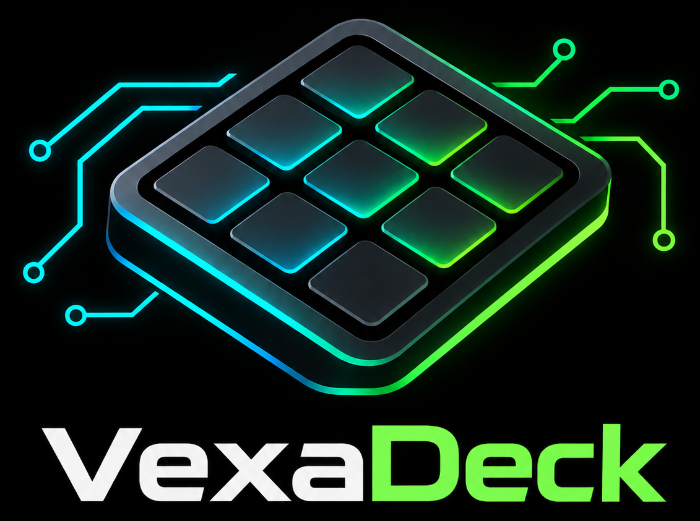

# VexaDeck 🎛️

Botonera macro local y monitor de telemetría por LAN para Windows. Convierte cualquier celular o tablet en un Stream Deck personal con cero dependencias en la nube y privacidad absoluta.



## ✨ Características principales

- **100% Local & Privado**: Sin cuentas, sin nube, sin telemetría ni analítica en internet. Todo el tráfico corre en tu red Wi-Fi local.
- **Conexión Segura (HTTPS/WSS)**: Autoridad de Certificación (CA) local propia con certificados SAN dinámicos para tus IPs locales. Emparejamiento por código QR de un solo uso.
- **Botonera Táctil PWA**: Interfaz moderna en React + Vite + Tailwind con respuesta háptica (`navigator.vibrate`), pulsos de luz reactivos y modo OLED negro puro.
- **Auto-Switching de Perfiles**: Detección pasiva en tiempo real (`SetWinEventHook`) del programa enfocado en Windows (VS Code, Spotify, juegos, terminal) con transiciones suaves y acento de color propio.
- **Telemetría en Vivo (4 slots)**: Monitoreo continuo de hardware con LibreHardwareMonitor (carga y temperatura de CPU/GPU, memoria RAM y velocidad de red pasiva). Alertas de temperatura (>85°C) con pulso y vibración.
- **Acciones y Multimedia**: Atajos de teclado (`hotkey`), control de volumen maestro y por aplicación (WASAPI), cambio de salidas de audio, toggles sincronizados con Windows y widget *Now Playing* (GSMTC).
- **Portapapeles Bidireccional**: Envía y recibe texto entre el celular y la PC al instante con historial de los últimos 10 elementos en memoria.
- **Scripts Seguros (.vbs)**: Ejecución de scripts locales con lista blanca estricta y protección contra path-traversal.
- **Panel de Configuración Completo**: Editor visual de grilla, creador de perfiles y botones, vinculación de procesos y exportación/importación en una ventana nativa WebView2.

### Novedades en 1.1.0
- **Spotify vinculado**: conectá tu cuenta desde el panel con OAuth 2.0 + PKCE (sin Client Secret). Los tokens se guardan cifrados con DPAPI y se renuevan solos.
- **Botones de Spotify**: nueva acción `spotify` en el editor para reproducir/pausa, siguiente y anterior sobre la cuenta vinculada.
- **Canción actual en el panel**: la tarjeta de integración muestra qué está sonando y permite desconectar la cuenta.

El historial completo de versiones está en [`CHANGELOG.md`](CHANGELOG.md).

---

## 🚀 Instalación y Uso

### Opción 1: Instalador oficial (Recomendada)
Descargá `VexaDeck-Setup-1.1.1.exe` desde la sección de lanzamientos o compilalo con el script de empaquetado.
- Configura automáticamente la tarea programada sin UAC para arrancar con Windows.
- Crea las reglas necesarias en el Firewall de Windows para red privada.
- Te permite elegir la carpeta donde se almacenan tus datos y configuraciones.

### Opción 2: Versión Portable
Descargá y descomprimí `VexaDeck-1.1.1-portable.zip` en cualquier carpeta o pendrive. Los datos se guardan en la subcarpeta local `data/`.

### Opción 3: App Android
Descargá `VexaDeck-Android.apk` desde el release, aceptá "instalar apps de esta fuente" y escaneá el QR de **Panel → Emparejar → Android (app)**. Requiere Android 8 o superior y no necesita ningún certificado. Detalles de compilación y firma en [`docs/ANDROID.md`](docs/ANDROID.md).

---

## 🛠️ Compilación desde el código fuente

### Requisitos
- Windows 10 (versión 2004+) o Windows 11
- .NET 8 SDK
- Node.js 18+ y npm
- Inno Setup 6 (opcional, para compilar el instalador `.exe`)

### Pasos de compilación rápida

Ejecutá el script de build integral:
```powershell
powershell -ExecutionPolicy Bypass -File installer/build.ps1
```

Este script compila el frontend PWA, publica el servidor .NET auto-contenido y genera tanto el archivo portable `.zip` como el instalador `VexaDeck-Setup-1.1.1.exe` en la carpeta `dist/`.

Para la app Android hace falta además JDK 17 y el Android SDK:
```bash
npm --prefix web run build:native
cd mobile && npm ci && npx expo prebuild --platform android
cd android && ./gradlew assembleRelease
```

---

## 📂 Estructura del Proyecto

```
VexaDeck/
├── server/              # Backend .NET 8 (Kestrel, WASAPI, WebView2, Tray)
│   └── src/VexaDeck.Server/
├── web/                 # Frontend Móvil PWA (React, TypeScript, Vite, Tailwind)
├── mobile/              # App Android (Expo + módulo Kotlin vexadeck-net)
├── installer/           # Script Inno Setup 6 y build.ps1
├── dist/                # Binarios de distribución e instaladores
├── docs/                # Documentación técnica y arquitectura
└── landing/             # Landing page promocional (HTML estático)
```

---

## 📖 Documentación adicional

- [English Documentation (README.en.md)](README.en.md)
- [Arquitectura del Sistema (docs/ARQUITECTURA.md)](docs/ARQUITECTURA.md)
- [Protocolo WebSocket y Seguridad (docs/PROTOCOLO.md)](docs/PROTOCOLO.md)
- [Política de Seguridad (SECURITY.md)](SECURITY.md)
- [Avisos de Terceros y Licencias (THIRD-PARTY-NOTICES.md)](THIRD-PARTY-NOTICES.md)
- [Guía de Contribución (CONTRIBUTING.md)](CONTRIBUTING.md)

---

## 📄 Licencia

Este proyecto está bajo la Licencia MIT. Consultá el archivo [LICENSE](LICENSE) para más detalles.
