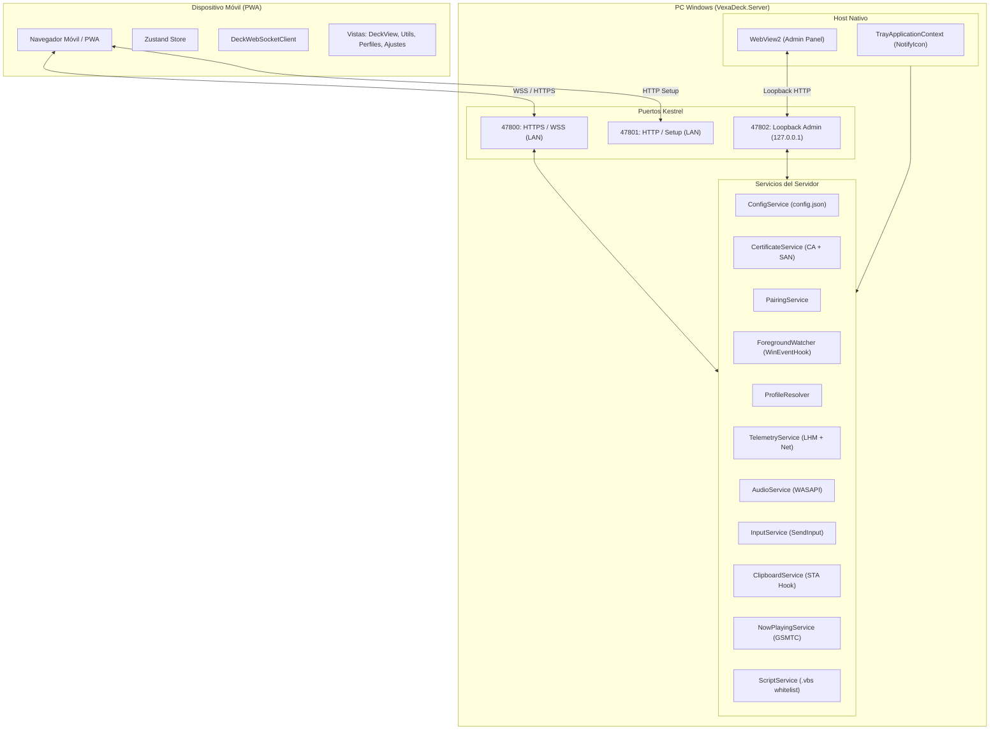

# Arquitectura de VexaDeck

VexaDeck está diseñado como una solución 100% local dividida en dos componentes principales: el **Servidor de Escritorio Windows** y el **Cliente Móvil Web (PWA)**.



## Flujo de datos y eventos

1. **Arranque del servidor**:
   - Resuelve `DataDir` según la prioridad: argumento `--data-dir`, `portable.flag`, `bootstrap.json` o `%AppData%\VexaDeck`.
   - Consulta `http://127.0.0.1:47802/api/health` para garantizar instancia única. Si ya existe una instancia, solicita `POST /api/admin/show-window` y finaliza.
   - Genera la Autoridad Certificadora (CA) y el certificado de servidor con los Subject Alternative Names (SAN) de las IPs locales.
   - Inicia los listeners de Kestrel y el bucle de telemetría pasiva.
2. **Emparejamiento y conexión**:
   - El administrador muestra un código QR que apunta a `http://<IP>:47801/setup?code=...`.
   - El celular descarga e instala `ca.crt`, tras lo cual navega a `https://<IP>:47800/`.
   - El celular canjea el código en `POST /api/pair` y recibe un token criptográfico que almacena en `localStorage`.
   - Abre un WebSocket seguro a `wss://<IP>:47800/ws` enviando `hello` con el token.
   - El servidor valida el hash SHA-256 del token y responde con `welcome`, transmitiendo la configuración, estados iniciales de audio, perfil activo y estado de Now Playing.
3. **Auto-Switching de Perfiles**:
   - `ForegroundWatcher` escucha eventos `EVENT_SYSTEM_FOREGROUND` con debounce de 150 ms.
   - Resuelve el proceso de primer plano (incluyendo ventanas UWP hijas de `ApplicationFrameHost.exe`).
   - `ProfileResolver` busca el proceso en las listas `match.processes` de cada perfil.
   - Si cambia de perfil y no está fijado manualmente, emite el evento `profile.changed` a través de WebSocket.
4. **Telemetría y Alertas**:
   - `TelemetryService` muestrea métricas cada segundo sin generar I/O en disco.
   - El servidor difunde el payload `telemetry` con las métricas actuales a los clientes conectados.
   - Si la temperatura supera los 85°C, el cliente activa la animación de pulso y la vibración táctil configurada.

---

## v0.3.0 — capas nuevas

```
mobile/                     App Android (Expo, Kotlin)
├─ src/native/              protocolo v2, conexión, storage, descubrimiento, WoL
├─ src/screens/             Mis PCs · Agregar PC · Shell (WebView)
└─ modules/vexadeck-net/    módulo Kotlin: magic packet, mDNS lock, subredes

server/src/VexaDeck.Server/
├─ Services/ProtocolV2.cs   HMAC/HKDF y sobres firmados
├─ Services/HostIdentityService.cs  serverId, nombre, color, /api/ident, deep link
├─ Services/MdnsAdvertiser.cs       responder mDNS/DNS-SD sin dependencias
├─ Services/AdbService.cs           USB opt-in (reverse, install, pair)
├─ Services/WakeOnLan.cs            magic packet para probar desde el panel
└─ Services/Dpapi.cs                claves v2 protegidas con DPAPI

web/src/shared/transport/    BrowserTransport (PWA) · NativeTransport (bridge)
web/src/client/store/        hosts[serverId] + activeHostId
```

El servidor mantiene v1 y v2 sobre el mismo Kestrel. `/ws` conserva el
comportamiento de la v0.2; `/ws2` agrega identidad, firmas y multi-PC.

`config.json` pasa a versión 3 con `host` (identidad de la PC), `revision`
(para que el celular evite recargas innecesarias) y dispositivos con
`protocol`, `deviceKeyProtected` y `transport`. La migración es automática y
conserva `config.bak.json`.
